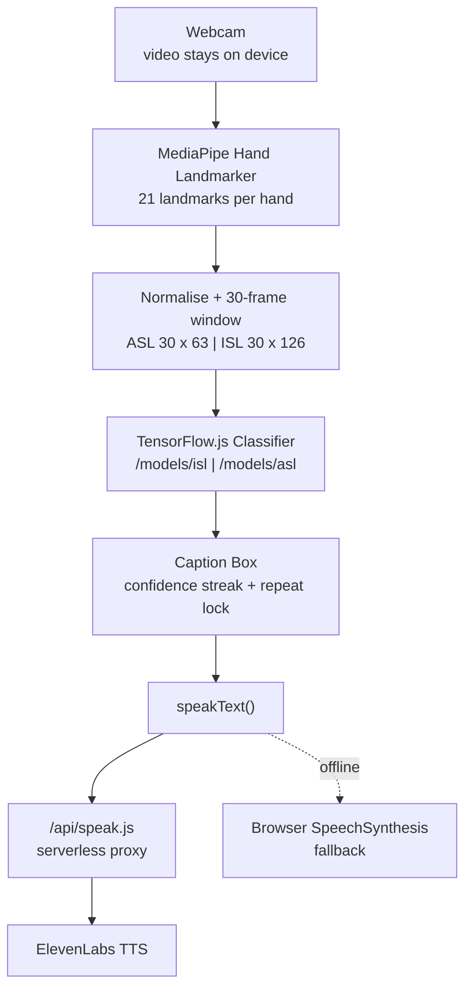
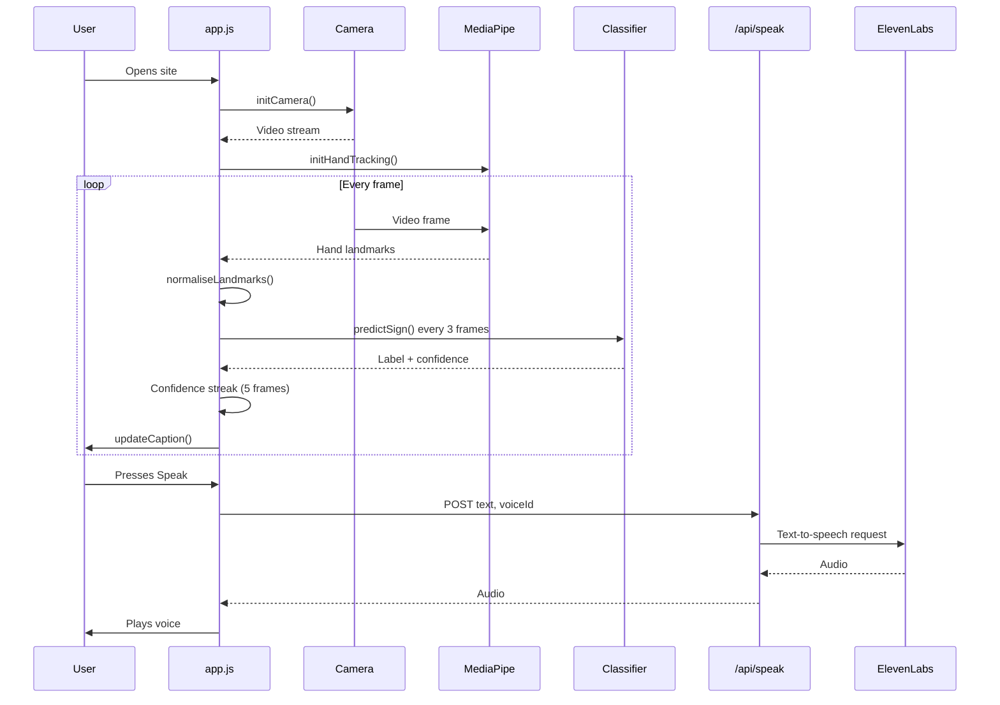

## Hatho Ki Vaani (हाथों की वाणी)

<!-- Add a screenshot or thumbnail here:  -->

*Hatho Ki Vaani ("Your hands. Your voice.") is a real-time sign language to text and voice translator that runs in the browser. It uses the webcam and MediaPipe to track hands, TensorFlow.js classifiers to recognise Indian Sign Language (ISL, 2 hands) and American Sign Language (ASL, 1 hand), and shows recognised signs as live captions. A serverless proxy keeps the ElevenLabs key secret so the captions can be spoken in a male or female voice. All video is processed on the user's device.*

## Full App Flow Inshort
The browser opens the webcam, MediaPipe finds the hand landmarks in each frame, the landmarks are normalised and collected into a 30-frame window, a classifier predicts the sign, and a confident sign is added to the caption box. When the user presses Speak (or, in a later release, shows a double thumbs-up), the caption is sent to `/api/speak`, which calls ElevenLabs and returns audio.

## Live Demo

- **Website:** [https://hatho-ki-vaani-fixed.vercel.app](https://hatho-ki-vaani-fixed.vercel.app)
- **No sign-up or login needed.** Open the site, allow the camera, and start signing.
- **Demo mode:** with `USE_DEMO_MODE = true` the signs are simulated, so the app can be tested before real models exist.

## Build Status

| Part | Feature | Status |
|------|---------|--------|
| 1 | Core app: camera, hand tracking, ISL/ASL toggle, live caption, demo mode | Built |
| 2 | Male/female voice (ElevenLabs proxy + browser fallback) | Planned |
| 3 | Hands-free double thumbs-up speak gesture | Planned |
| 4 | Sign library and multilingual dictionary | Planned |
| 5 | How-to video, guided tutorial, FAQ | Planned |
| 6 | Light / Dark / System theme | Planned |
| 7 | Logo and pastel branding polish | Planned |
| 8 | 8 interface languages, settings panel, caption history | Planned |

## Features Implemented
- Live hand tracking with MediaPipe, with landmarks drawn over the camera feed.
- ISL (2 hands, 42 landmarks) and ASL (1 hand, 21 landmarks) toggle, remembered in localStorage.
- Sliding window of 30 frames, prediction every 3 frames, adjustable confidence threshold (default 80%).
- A sign is accepted only after its confidence stays above the threshold for 5 frames; repeats are ignored until the hands leave or the sign changes.
- Auto-space after 1.5 seconds with no hands.
- Caption box with Speak, Clear, Undo, Add space, Mute, Start/Stop camera and A- / A+ text size.
- Error states for blocked camera, no camera and failed model load, plus a loading screen with tips.
- Demo mode with a mock classifier.

## How I Approached the Problem
I started by keeping everything in the browser: no build tools, no server for video, so privacy is built in. The app is split into small functions (`initCamera()`, `initHandTracking()`, `normaliseLandmarks()`, `predictSign()`, `updateCaption()`, `speakText()`), each doing one job.

To make recognition stable, landmarks are made position-independent by subtracting the wrist and dividing by hand size. A sliding window gives the classifier motion context, and a confidence streak plus a repeat lock stops one held sign from filling the caption with duplicates.

The ElevenLabs key never goes in browser code. A serverless function (`/api/speak.js`) reads it from an environment variable and returns audio, so the frontend only calls `/api/speak`.

## Trade-offs I Made
- I used plain HTML, CSS and vanilla JavaScript for zero build steps and easy deployment, but a framework would scale better for a very large app.
- Hand tracking is loaded from a CDN, so the first load needs internet.
- A demo classifier lets everything be tested early, but real accuracy depends entirely on the models you train.
- Browser speech is used as a free fallback, but it sounds less natural than ElevenLabs.

# App Architecture



## Flow Summary
*Step-by-step application flow breakdown*

### `01` Entry Point
**`index.html`** loads `style.css` and `app.js` (as a module) and the TensorFlow.js CDN script.

### `02` Camera
**`initCamera()`** asks for webcam access, starts the video and the frame loop, and reports blocked or missing cameras.

### `03` Hand Tracking
**`initHandTracking()`** loads MediaPipe from the CDN (GPU first, CPU fallback) and detects up to 2 hands per frame.

### `04` Landmark Processing
- `normaliseLandmarks()` subtracts the wrist and divides by hand size.
- `buildFeatureVector()` makes 63 numbers for ASL, or 126 for ISL with the missing hand padded with zeros.

### `05` Prediction
**`predictSign()`** runs every 3 frames on the 30-frame window (or the mock classifier in demo mode).

### `06` Caption
**`trackConfidence()`** accepts a sign after 5 confident frames, and **`updateCaption()`** adds it to the caption box.

### `07` Voice
**`speakText()`** speaks the caption. Part 2 adds the ElevenLabs proxy, male/female voices, caching and fallback.

## Tech Stack
*Versions used in the project*

### Frontend
<table>
<tr>
<td><strong>HTML / CSS</strong><br><sub>No build tools</sub></td>
<td><strong>Vanilla JS</strong><br><sub>ES modules</sub></td>
<td><strong>MediaPipe Tasks Vision</strong><br><sub>0.10.14</sub></td>
<td><strong>TensorFlow.js</strong><br><sub>4.20.0</sub></td>
</tr>
</table>

### Voice & Backend
<table>
<tr>
<td><strong>ElevenLabs</strong><br><sub>Text-to-speech</sub></td>
<td><strong>Vercel Functions</strong><br><sub>/api/speak.js</sub></td>
<td><strong>SpeechSynthesis</strong><br><sub>Browser fallback</sub></td>
</tr>
</table>

## Component Interaction Flow



## Project Structure
*Folder structure*

```
hatho-ki-vaani/
├── index.html          # page layout
├── style.css           # styles and colour variables
├── app.js              # app logic, constants at the top
├── logo.svg
├── README.md
├── api/
│   └── speak.js        # ElevenLabs proxy (Part 2)
├── models/
│   ├── isl/            # model.json + labels.json (input 30 x 126)
│   └── asl/            # model.json + labels.json (input 30 x 63)
├── locales/            # translations (Part 8)
├── images/             # sign images (Part 4)
└── subtitles/          # .vtt files (Part 5)
```

## Quick Start
*Get up and running in minutes*

### Prerequisites

<table>
<tr>
<td><strong>Modern browser</strong><br><sub>Chrome, Edge, Safari, Firefox</sub></td>
<td><strong>Webcam</strong><br><sub>Camera access allowed</sub></td>
<td><strong>VS Code + Live Server</strong><br><sub>Or any local web server</sub></td>
</tr>
</table>

### `01` Run Locally

The camera only works on `localhost` or `https`, not by double-clicking `index.html`.

```bash
# Option A: VS Code Live Server
# Right-click index.html -> Open with Live Server

# Option B: any static server
npx serve .
```

### `02` Use Real Models

At the top of `app.js`:

```js
const USE_DEMO_MODE = true;   // set to false to use real models
```

Put your TensorFlow.js models in `/models/asl/` and `/models/isl/` (`model.json` and `labels.json`):

- **ASL:** input shape `30 x 63`
- **ISL:** input shape `30 x 126`

### `03` Voice Setup (Part 2)

```bash
# Vercel environment variable (never put the key in browser code)
ELEVENLABS_API_KEY=your-key-here
```

Then set `VOICE_MALE_ID` and `VOICE_FEMALE_ID` at the top of `app.js`.

## API Reference

### POST Endpoints

<table>
<tr><th>Endpoint</th><th>Description</th></tr>
<tr><td><code>/api/speak</code></td><td>Send <code>{ text, voiceId }</code>, receive audio from ElevenLabs (Part 2)</td></tr>
</table>

> Note: the ElevenLabs API key is read from `ELEVENLABS_API_KEY` on the server and is never exposed to the browser.

## Data Format
*Sign library entries (Part 4)*

```js
SIGN_LIBRARY = { asl: { alphabet: [...], words: [...], sentences: [...] }, isl: { ... } }
// entry: { id, category, labels: {en, hi, es, fr, pt, ar, zh, bn}, description: {...}, image, video }
```

## Deployment
*Production deployment*

<table>
<tr><th>Service</th><th>Platform</th></tr>
<tr><td><strong>Frontend</strong></td><td>Vercel</td></tr>
<tr><td><strong>Voice proxy</strong></td><td>Vercel Function (Netlify Function also possible)</td></tr>
<tr><td><strong>Models</strong></td><td>Static files in <code>/models</code></td></tr>
</table>

## Project Limitations & Assumptions:

- Recognition quality depends on the TensorFlow.js models you provide; demo mode only simulates signs.
- Hand tracking loads from a CDN, so an internet connection is needed on first load.
- Works best with good lighting, a plain background and hands fully in frame.
- The camera needs `https` or `localhost`.
- Sign images in the library are placeholders or simple original drawings; none are claimed to be verified or official.
- Part 2 to Part 8 features are planned and not yet built (see Build Status).

*Made by [Your Name]*
*Let's connect on [LinkedIn](https://linkedin.com/in/your-profile)*
